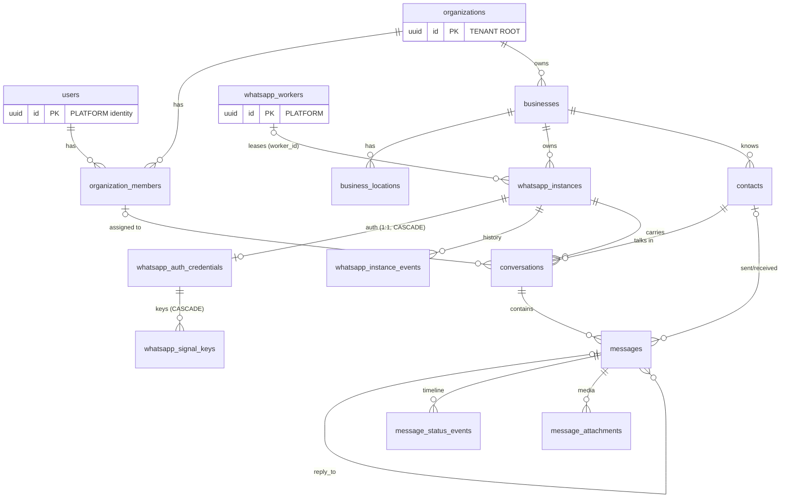
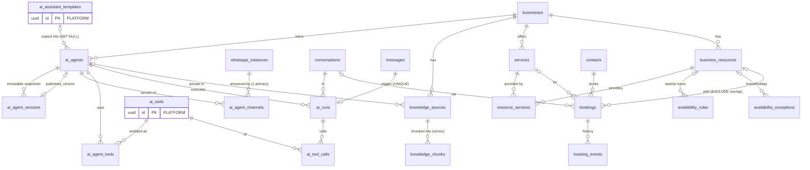
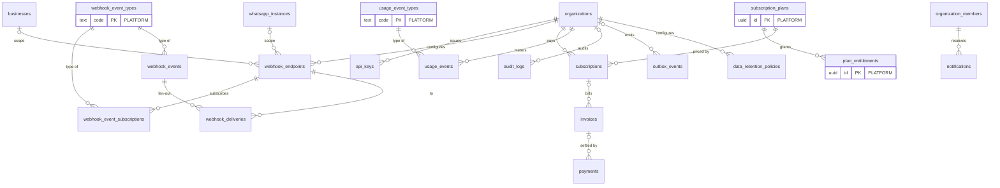

# Entity Relationship Diagram

Composite FKs (`(x_id, organization_id[, business_id])`) are shown as ordinary relationships.
Every box except those marked **PLATFORM** carries `organization_id` and is RLS-protected.

## Tenancy, WhatsApp, messaging

## AI, knowledge, booking

## Integration, billing, operations

